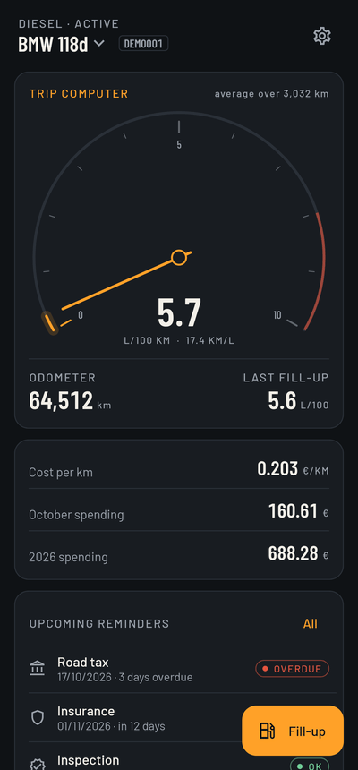
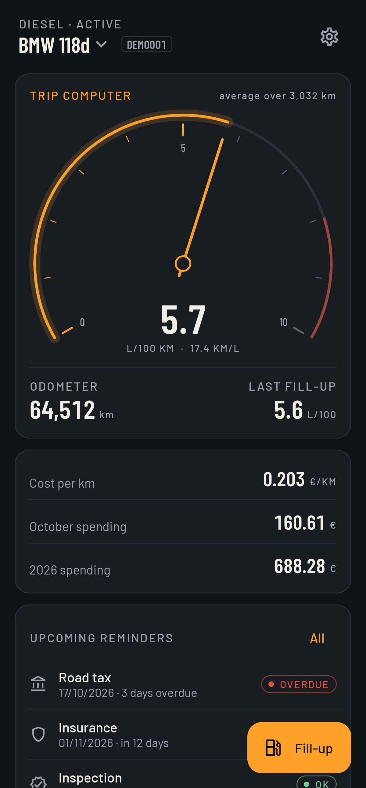
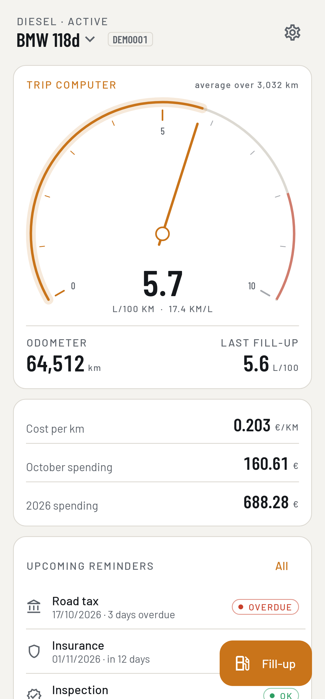
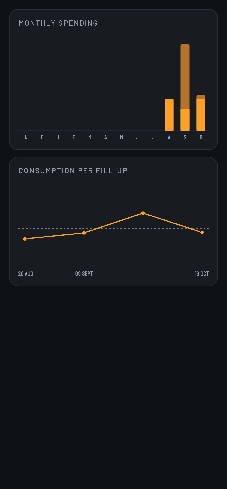
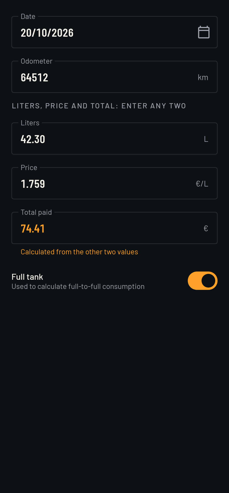
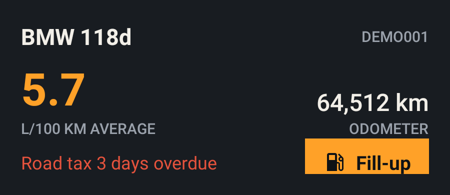
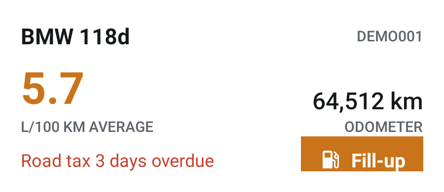

<p align="center">
  
</p>

# Fuel Ledger

An offline Android car logbook for fuel, running costs and maintenance reminders. Built in Kotlin and Jetpack Compose, with an amber instrument cluster that follows your phone's light or dark theme.

No account. No analytics. No network permission. Your records stay on your phone.

## Dashboard in motion

<p align="center">
  
</p>

The demo uses actual Compose test frames and synthetic records. The needle shows calculated consumption, not live vehicle telemetry. A [static dashboard](docs/screenshots/dashboard_night.png) is available if you prefer no animation.

## Features

- **Trip computer:** average consumption in L/100 km and km/L, rolling odometer, cost per kilometer, monthly and yearly spending.
- **Fill-ups:** date, odometer, liters, unit price and total. Enter any two monetary/volume values to calculate the third. Odometer validation checks neighboring fill-ups.
- **Receipt scan:** take a photo or pick one from the gallery to fill in liters, price, total and date. Text recognition runs on the phone with the bundled ML Kit model, and the photo is deleted after reading. The odometer is always entered by hand.
- **Home screen widget:** average consumption, odometer, the most urgent reminder and a fill-up shortcut that opens the form directly. It follows the phone's light or dark theme.
- **Full-to-full consumption:** partial fill-ups between two full tanks count toward the same segment. A distance-weighted average avoids misleading results.
- **Expenses:** maintenance, tires, tolls, parking and other costs, with category filters and swipe-to-delete with undo.
- **Reminders:** road tax, insurance, inspection and servicing, by date or kilometer threshold. A daily local notification warns you in advance.
- **Renewal:** move a reminder forward by its preset interval. Inspection defaults to 24 months; other types default to 12 months. Check the rules that apply to your vehicle.
- **Charts:** monthly fuel/other spending and consumption per full tank, with tap-to-inspect values.
- **Multiple vehicles** and a single-file **CSV backup**, selected through Android's document picker.
- **Brand motion:** cold-start needle rise, dashboard ignition sweep and rolling odometer digits. The splash skips motion when system animations are disabled.

The interface and repository documentation are in English. Units remain kilometers, liters and euros.

## Screenshots

| Night dashboard | Day dashboard |
|:---:|:---:|
|  |  |

| Charts | Fill-up form |
|:---:|:---:|
|  |  |

| Night widget | Day widget |
|:---:|:---:|
|  |  |

## Install

Signed APKs are published on [GitHub Releases](https://github.com/FrancescoCastaldi/fuel-ledger-android/releases), not on Google Play. See [installing and updating](docs/install.md) for automatic updates with Obtainium, the signing certificate fingerprint and how to move from a debug build.

## Encrypted source

The source code on GitHub is encrypted with [transcrypt](https://github.com/elasticdog/transcrypt) 2.3.2 (AES-256-CBC). `app/`, `tools/`, `build.gradle.kts`, `settings.gradle.kts` and `gradle.properties` are stored as ciphertext; documentation, screenshots, the Gradle wrapper and `build_apk.bat` stay readable. A configured clone encrypts on commit and decrypts on checkout, so local files are always plain text.

To unlock a fresh clone, run this from Git Bash in the repository root. The password is `FUEL_LEDGER_TRANSCRYPT_PASSWORD` in the maintainer's private `.env`:

```bash
bash /c/path/to/transcrypt -c aes-256-cbc -p "$FUEL_LEDGER_TRANSCRYPT_PASSWORD" -y
```

On Windows, pass the script as a `/c/...` path: transcrypt 2.3.2 stops silently when given a `C:/...` path. A configured clone keeps a copy of the script in `.git/crypt/transcrypt` and the password in `.git/config`. Without the password the code cannot be recovered from GitHub.

## Build

Requires Android SDK 34, JDK 17 or 21, and a network connection for the first dependency download. The Gradle 8.7 wrapper is included.

1. Set `JAVA_HOME` to your JDK.
2. Set `ANDROID_HOME` to your SDK, or add `sdk.dir=<your-sdk-path>` to the ignored `local.properties` file.
3. Run:

```powershell
.\gradlew.bat testDebugUnitTest
.\gradlew.bat assembleDebug
.\gradlew.bat assembleRelease
.\gradlew.bat lintDebug
```

On Windows, `build_apk.bat` runs tests, builds the release APK and copies it to `FuelLedger-v0.3.0.apk` in the project root. It can auto-detect the local portable toolchain, but standard environment variables work anywhere.

Without `keystore.properties`, release builds use the local Android debug key. This is suitable for personal testing, not distribution. Published releases use a personal key: the ignored `keystore.properties` file contains `storeFile` and `keyAlias`, and the password comes from the `FUEL_LEDGER_KEY_PASSWORD` environment variable, which `build_apk.bat` reads from the private workspace `.env` or asks for with hidden input. `storePassword` and `keyPassword` entries are still read if present. Keep the keystore and its password outside Git.

## Tests and demo generation

The JVM suite covers consumption, costs, reminders, form calculations, odometer validation, receipt parsing, the widget summary, CSV round trips, Room transactions and English formatting. Robolectric renders review screenshots of the app and the widget to `app/build/screenshots/`; these are visual review aids, not pixel-diff assertions.

`ScreenshotTest.dashboardDemoFrames` also writes 48 dashboard startup frames to `app/build/demo-frames/`. To regenerate the README GIF with FFmpeg:

```powershell
.\gradlew.bat testDebugUnitTest --tests "*.ScreenshotTest" --rerun-tasks
ffmpeg -y -framerate 15.625 -i app/build/demo-frames/frame_%03d.png -filter_complex "[0:v]scale=400:-1:flags=lanczos,split[a][b];[a]palettegen[p];[b][p]paletteuse" -loop 0 docs/demo/dashboard.gif
```

## Privacy and backups

Room stores data locally. Android automatic cloud backup is disabled, and the app does not request internet access: the manifest removes the network permissions that ML Kit declares for optional telemetry. Receipt photos go to the app cache through the system camera or photo picker, so no camera or storage permission is needed. CSV export is manual; choosing a cloud document provider can upload that file through the provider, not through Fuel Ledger. Import replaces all current records after confirmation.

Fuel Ledger has a new application ID. It installs separately from the earlier Italian prototype and does not automatically migrate its data. Its CSV format starts with `#fuel-ledger,1` and uses English enum names; prototype CSV files are not directly compatible.

## Project

Kotlin 2.0, Compose Material 3, Room 2.6, Navigation Compose, WorkManager, Jetpack Glance, ML Kit Text Recognition (bundled) and AndroidX Core SplashScreen. Minimum Android 8.0 (API 26), target API 34. The APK contains ARM native code only (`arm64-v8a`, `armeabi-v7a`).

- [Architecture map](codemap.md)
- [Changelog](CHANGELOG.md)
- [Brand assets](docs/brand/README.md)
- [Contributor instructions](AGENTS.md)

Barlow and Barlow Condensed are distributed under the SIL Open Font License, included in `docs/licenses/Barlow-OFL.txt`. No project-wide open-source license has been assigned.
